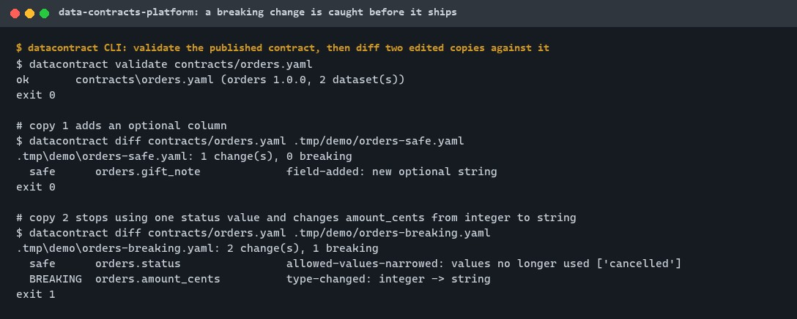
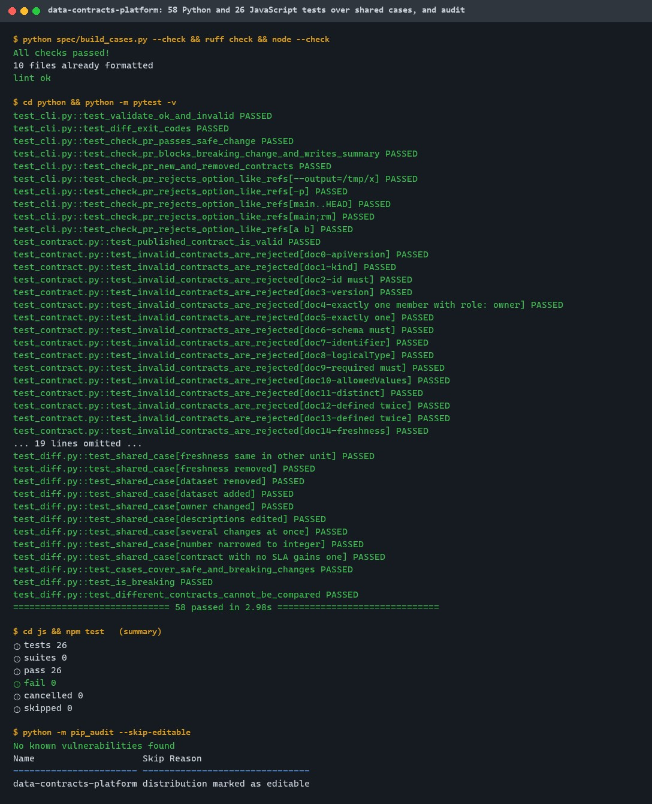
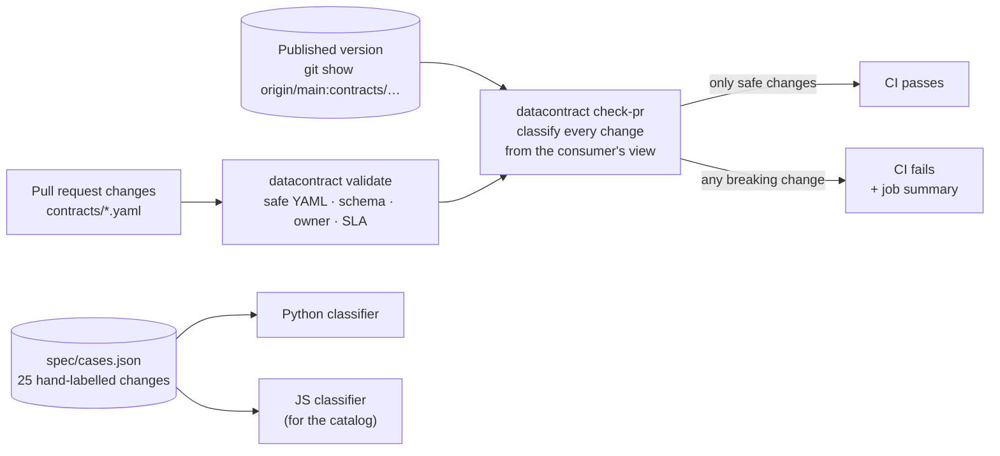
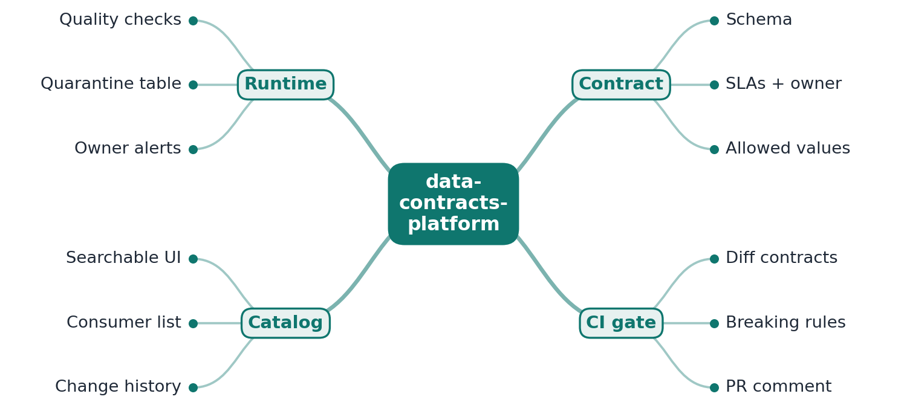
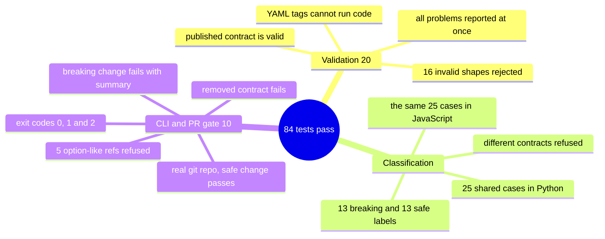

# data-contracts-platform

[](https://github.com/EquinoxWN/data-contracts-platform/actions/workflows/ci.yml)


> Stops an upstream change silently breaking every downstream dashboard: producers publish a contract and CI blocks breaking changes.

Part of my **Data Engineering** list · Python · JS · core project

## Proof it works

The CLI validates the published contract, then compares two edited copies with it: adding an optional column is safe (exit 0), changing `amount_cents` from integer to string is breaking (exit 1), which is what fails a pull request in CI:



58 Python and 26 JavaScript tests pass over the same shared cases, and the dependencies have no known vulnerabilities:



## Architecture

**What M1 runs today:**



**Full roadmap (M1 to M3):**



## How it works

_Steps 1 and 2 are built and tested (M1); the rest is on the [roadmap](#roadmap)._

1. A producing team describes a dataset in a YAML contract: schema, field meanings, freshness SLA, owner and allowed values.
2. On every pull request the CLI diffs the new contract against the published one and classifies each change as safe or breaking.
3. Breaking changes (a removed column, a narrowed type) fail CI and post a comment naming the downstream consumers that would break.
4. In production, quality checks run on each batch; rows that violate the contract go to a quarantine table instead of reaching consumers.
5. SLA misses and violation rates become metrics that alert the owning team, not the consumer.
6. A catalog page lists every contract with its owners, consumers and change history.

## Who it helps

- **Who:** Teams that produce datasets other teams depend on, and the analysts who consume them.
- **The problem:** A renamed column or a changed type upstream silently breaks dashboards and models downstream.
- **How to use it:** Describe a dataset in a YAML contract and run `datacontract diff` in a pull request check: it exits 0 for safe changes, 1 for breaking ones and 2 for an invalid contract.

## Tech stack

| Area | In M1 | Planned |
|---|---|---|
| Core | Open Data Contract Standard (YAML), Python CLI, the same classifier in JavaScript | - |
| CI | GitHub Actions `datacontract check-pr` that fails on breaking changes | PR comments naming affected consumers |
| Checks / UI | - | Soda Core quality checks, quarantine, contract catalog page |

One implementation per language, each in its own folder: `python/` (CLI and rules), `js/` (the same classifier for the catalog page).

| Path | What it is |
|---|---|
| `contracts/orders.yaml` | The published demo contract: two tables, owner, allowed values, 1 h freshness SLA |
| `python/src/data_contracts_platform/contract.py` | Safe YAML loading and validation (all problems reported at once) |
| `python/src/data_contracts_platform/diff.py` | Safe-or-breaking classification of every change |
| `python/src/data_contracts_platform/cli.py` | `datacontract validate`, `diff`, `check-pr` |
| `python/src/data_contracts_platform/gitbase.py` | Reads the published version with git (fixed arguments, refs validated) |
| `js/src/diff.js` | The same classifier in JavaScript |
| `spec/build_cases.py` → `spec/cases.json` | 25 hand-labelled changes both languages must classify identically |

| Change | Verdict |
|---|---|
| Field, dataset or contract removed; any type change except `integer` → `number` | breaking |
| Required → optional; new allowed value; allowed-values constraint dropped; primary key changed | breaking |
| Freshness SLA loosened or removed | breaking |
| Field, dataset or contract added; `integer` → `number`; optional → required; allowed value dropped | safe |
| Freshness tightened or added; owner or description edited | safe |

## Run it

Needs Python 3.11+, Node.js 24+ and git.

```bash
make setup   # install the Python package (adds the datacontract command)
make lint    # cases up to date, ruff, node --check
make test    # Python and JavaScript test suites
```

Use the CLI:

```bash
datacontract validate contracts/*.yaml
datacontract diff old/orders.yaml contracts/orders.yaml   # exit 1 if anything breaks consumers
datacontract check-pr --base origin/main contracts        # what CI runs on every pull request
```

Exit codes: `0` valid or only safe changes, `1` breaking change, `2` invalid contract or git error.

## Tests and results

Latest local run (full detail in [docs/results/m1.md](docs/results/m1.md)):

| Check | Result |
|---|---|
| Shared change cases, Python and JavaScript (13 breaking, 13 safe labels) | 25 / 25 identical in both languages |
| Invalid contracts rejected (16 shapes) and YAML code tags refused | all rejected |
| `check-pr` on a real git repo: safe change / breaking change / new / removed contract | pass / fail / pass / fail, as expected |
| Option-like or malformed git refs (`-p`, `--output=…`, `main..HEAD`) | 5 / 5 refused |
| Tests passed | Python 58, JavaScript 26 |

The gate on a real repository, after renaming a column, adding an order status and slowing the SLA from 1 h to 1 day:

```
contracts/orders.yaml: 4 change(s), 3 breaking
  BREAKING  orders                       freshness-loosened: 3600s -> 86400s
  BREAKING  orders.status                allowed-values-extended: new values ['refunded']
  BREAKING  orders.coupon_code           field-removed: consumers selecting it will fail
  safe      orders.coupon                field-added: new optional string
Breaking changes found: this pull request must not merge as is.
```

### Test map



## Roadmap

**M1** (≈15 h)
- [x] Write `docs/rfc/0001-design.md`: problem, goals, non-goals, chosen design
- [x] A producing team describes a dataset in a YAML contract: schema, field meanings, freshness SLA, owner and allowed values.
- [x] On every pull request the CLI diffs the new contract against the published one and classifies each change as safe or breaking.

**M2** (≈20 h)
- [ ] Breaking changes (a removed column, a narrowed type) fail CI and post a comment naming the downstream consumers that would break.
- [ ] In production, quality checks run on each batch; rows that violate the contract go to a quarantine table instead of reaching consumers.

**M3** (≈25 h)
- [ ] SLA misses and violation rates become metrics that alert the owning team, not the consumer.
- [ ] A catalog page lists every contract with its owners, consumers and change history.
- [ ] Publish the proof below with real numbers

## Proof

What this repo must show before it counts as done:

- A screenshot of CI blocking a breaking change, and a before/after count of data incidents in the demo scenario.

| Result | Value |
|---|---|
| M3 proof above | Not measured yet (M3). Current M1 numbers: see [Tests and results](#tests-and-results). |

## Why it matters

- **Interview angle:** 'How do you stop upstream changes breaking pipelines?'
- **Upstream I'd like to contribute to:** Open Data Contract Standard (Bitol) or Soda Core.

## Design docs

- [RFC 0001: design](docs/rfc/0001-design.md)
- [ADR 0001: record architecture decisions](docs/adr/0001-record-architecture-decisions.md)
- [ADR 0002: classify changes from the consumer's point of view, strictly](docs/adr/0002-classify-from-consumer-view.md)
- [M1 results](docs/results/m1.md)

## Scope

This is a learning and portfolio system, not a hosted production service. Everything runs locally.

## Security and contributing

- Every GitHub Action is pinned to a commit SHA; workflows run read-only, without persisted credentials.
- Dependabot proposes dependency and action updates weekly.
- `ruff` with security (bandit) rules and `ruff format --check` on every push; contracts load with the safe YAML loader; git runs with fixed arguments and validated refs; `pip-audit` (`make audit`) in CI.
- Report vulnerabilities privately: see [SECURITY.md](SECURITY.md). To contribute, see [CONTRIBUTING.md](CONTRIBUTING.md).

## License

MIT, see [LICENSE](LICENSE).
